 

## About

I build full-stack products end to end: storefronts, admin dashboards and the APIs behind them.
My day-to-day is **Next.js + NestJS + MongoDB**, with payments, order flows and mobile apps in the mix.

- Marketplaces and e-commerce: catalogues, carts, checkout, payouts
- Admin tooling that non-technical teams can actually run a business from
- Clean REST APIs, typed with TypeScript from database to UI

## Stack

<picture>
  <source media="(prefers-color-scheme: dark)" srcset="assets/terminal-dark.svg" />
  <source media="(prefers-color-scheme: light)" srcset="assets/terminal-light.svg" />
  
</picture>

## Public work

| Project | Stack |
| --- | --- |
| [cynosure-customer](https://github.com/ShuhaibAp/cynosure-customer) | JavaScript |
| [cynosure-server](https://github.com/ShuhaibAp/cynosure-server) | TypeScript |
| [Kanben-task-manager](https://github.com/ShuhaibAp/Kanben-task-manager) | TypeScript |
| [HM_AI](https://github.com/ShuhaibAp/HM_AI) | Python |

## Contributions

<picture>
  <source media="(prefers-color-scheme: dark)" srcset="https://raw.githubusercontent.com/ShuhaibAp/ShuhaibAp/output/snake-dark.svg" />
  <source media="(prefers-color-scheme: light)" srcset="https://raw.githubusercontent.com/ShuhaibAp/ShuhaibAp/output/snake-light.svg" />
  
</picture>

